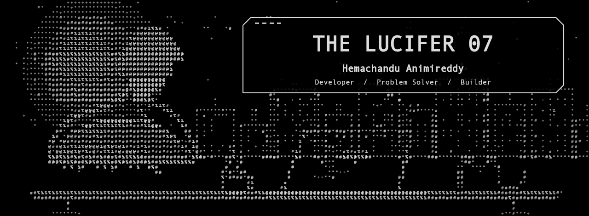
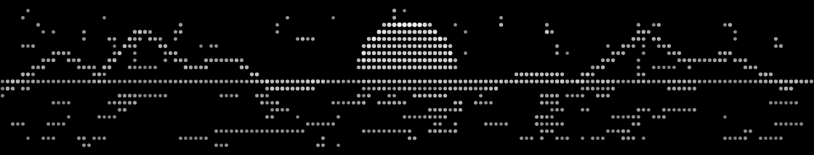

# THE LUCIFER 07

**Hemachandu Animireddy** · Developer · Problem Solver · Builder



## `> whoami`

A developer who enjoys turning ideas into useful, scalable, and meaningful software. Interested in building web applications, exploring applied AI, and understanding how real systems work beneath the surface. Curious by nature, consistent by practice, and driven to keep building.

## `> philosophy`

> **Learn Deeply.**
>
> **Build Thoughtfully.**
>
> **Solve Meaningfully.**

## `> tech_stack --view`

 **Java** ·  **JavaScript** ·  **Python** ·  **SQL** ·  **React**

 **MongoDB** ·  **PostgreSQL** ·  **Spring Boot** ·  **Node.js** ·  **Docker**

## `> focus --now`

- [ ] Strengthening system design
- [ ] Deepening backend and database skills
- [ ] Improving problem-solving and DSA
- [ ] Exploring applied AI (LLMs, RAG, agents)
- [ ] Building production-ready applications

## `> a_bit_more`

```text
location : Visakhapatnam, India
learning : Continuously
mode     : Build > Learn > Repeat
status   : Open to Collaborate
```



## `> connect`

[GitHub](https://github.com/TheLucifer-07) · [LinkedIn](https://www.linkedin.com/in/hemachandu-animireddy) · [Portfolio](https://portfolio-3005.vercel.app) · [Email](mailto:hemachanduanimireddy@gmail.com)

`THINK CLEARLY. ENGINEER DEEPLY. BUILD MEANINGFULLY.`
